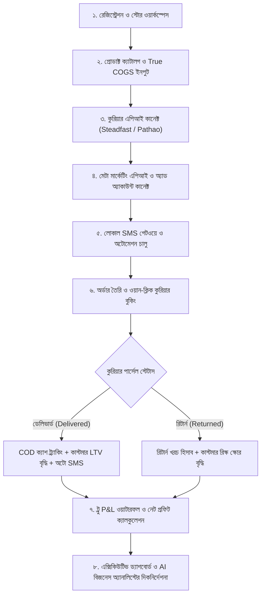
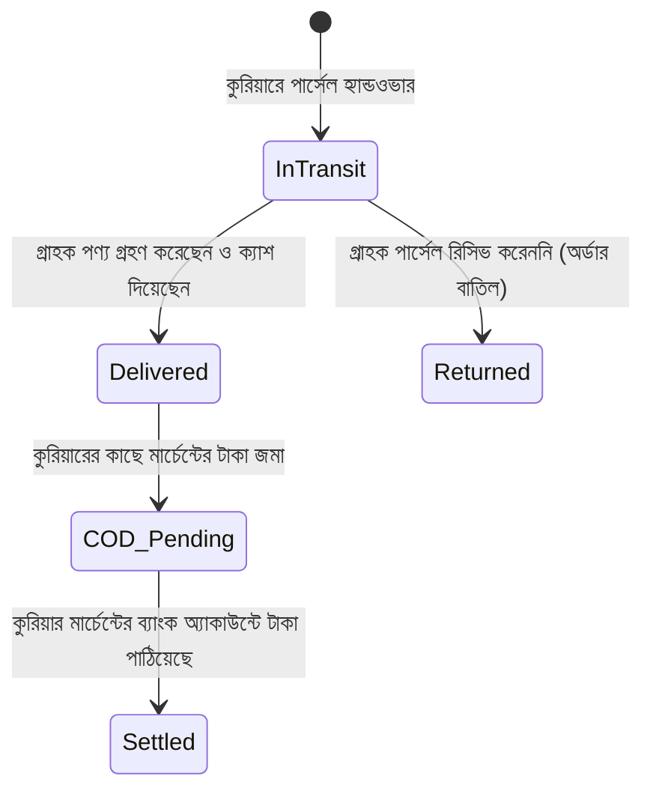
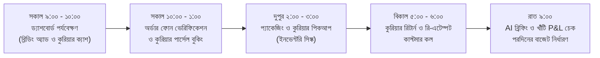

# ই-কমার্স প্রফিট & অ্যাডস ইন্টেলিজেন্স — নতুন ইউজারের পূর্ণাঙ্গ ওয়ার্কফ্লো ও বিজনেস গাইডলাইন

> **উদ্দেশ্য:** একজন নতুন ই-কমার্স উদ্যোক্তা / মার্চেন্ট সিস্টেমে অ্যাকাউন্ট খোলার পর থেকে শুরু করে কীভাবে প্রতিটি মডিউল ধাপে ধাপে ব্যবহার করবেন, তার প্রাত্যহিক ওয়ার্কফ্লো কেমন হবে এবং প্রতি ধাপে সিস্টেম থেকে কী ফলাফল পাওয়া যাবে — তার সহজ ও বিস্তারিত ব্যবহারিক গাইডলাইন।

---

## 🧭 সিস্টেমের মূল দর্শন (Core Philosophy)

> 💡 **"মেটার ড্যাশবোর্ডে ৪x বা ৫x ROAS দেখালেও মাস শেষে ব্যাংকে টাকা থাকে না কেন?"**

বাংলাদেশে ফেসবুক বিজ্ঞাপনের মাধ্যমে পণ্য বিক্রির ক্ষেত্রে সবচেয়ে বড় সমস্যা হলো **রিটার্ন পার্সেল (RTO - Return to Origin)** এবং **অনাদায়ি ক্যাশ অন ডেলিভারি (COD)**। মেটা শুধুমাত্র পিক্সেল পারচেজ ট্র্যাক করে বিজ্ঞাপনকে সফল দেখায়, কিন্তু কুরিয়ার ডেলিভারি চার্জ, রিটার্ন লস, সিওডি ১% ফি এবং প্যাকেজিং খরচের হিসাব তাদের কাছে থাকে না।

এই প্ল্যাটফর্মটি আপনার **মেটা অ্যাড স্পেন্ড + প্রোডাক্ট কস্ট (COGS) + কুরিয়ার ডেলিভারি ও রিটার্ন খরচ + অফিস অপেক্স** একত্রিত করে আপনাকে দেখায় **খাঁটি পকেট প্রফিট (Ground-Truth Net Profit)**।

---

## 🔄 সম্পূর্ণ বিজনেসের এন্ড-টু-এন্ড লাইফসাইকেল (High-Level Overview)

---

## 📌 ধাপ ১: রেজিস্ট্রেশন ও স্টোর ওয়ার্কস্পেস সেটআপ (Onboarding & Workspace Setup)

### ইউজার যা করবেন:
1. ব্রাউজারে সাইনআপ পেজে গিয়ে নাম, ইমেইল, ১১-ডিজিট বাংলাদেশি মোবাইল নম্বর এবং পাসওয়ার্ড দিয়ে রেজিস্ট্রেশন সম্পন্ন করবেন।
2. নতুন স্টোরের জন্য একটি ইউনিক ওয়ার্কস্পেস তৈরি করবেন:
   - **স্টোরের নাম (Store Name):** যেমন: *Heritage Silk Fashion*
   - **স্টোর স্লাগ (Store Slug):** যেমন: `heritage-silk`
   - **কারেন্সি (Currency):** `BDT (৳)`
   - **টাইমজোন (Timezone):** `Asia/Dhaka`
   - **অ্যাকাউন্টিং ডেট বেসিস (Date Basis):** `delivery_date` (ডেলিভারি হওয়ার দিনে লাভ হিসাব) অথবা `order_date` (অর্ডারের দিনে লাভ হিসাব)।

### সিস্টেমে প্রত্যাশিত ফলাফল (Expected Result):
- ডেটাবেজে সম্পূর্ণ পৃথক মাল্টি-টেন্যান্ট আইসোলেশন তৈরি হবে (অন্য মার্চেন্টের ডেটার সাথে কোনো মিশ্রণ ঘটবে না)।
- ইউজারকে স্বয়ংক্রিয়ভাবে `OWNER` পারমিশন প্রদান করা হবে।
- সিকিউর JWT টোকেন তৈরি হয়ে ইউজার সরাসরি ড্যাশবোর্ডে লগইন হবেন।

---

## 📌 ধাপ ২: প্রোডাক্ট ক্যাটালগ ও খাঁটি COGS সেটআপ (True COGS & Inventory)

### ইউজার যা করবেন:
প্রোডাক্ট মেন্যুতে গিয়ে প্রতিটি প্রোডাক্ট এবং তার সাইজ/কালার ভ্যারিয়েন্ট যোগ করবেন। শুধুমাত্র পাইকারি কেনাদাম নয়, প্রতিটি অর্ডারে আনুষঙ্গিক খরচগুলোও উল্লেখ করবেন:
- **রেগুলার বিক্রয়মূল্য (Selling Price):** যেমন: ৳১,৫০০.০০
- **বেস ক্রয়মূল্য (Base Cost Price):** যেমন: ৳৭৫০.০০
- **প্যাকেজিং খরচ (Packaging Cost):** যেমন: ৳৩৫.০০ (প্রিমিয়াম বক্স, বাবল র‍্যাপ ও সিকিউরিটি টেপ)
- **হ্যান্ডলিং খরচ (Handling Cost):** যেমন: ৳১৫.০০ (প্যাকিং স্টাফ লেবার ও ইনভয়েস প্রিন্ট)
- **প্রাথমিক স্টক (Stock Quantity):** যেমন: ১০০ পিস।

### সিস্টেমে প্রত্যাশিত ফলাফল (Expected Result):
- সিস্টেম প্রতিটি প্রোডাক্টের জন্য **True Unit Cost** নির্ধারণ করবে:
  $$\text{True Unit Cost} = ৳৭৫০ + ৳৩৫ + ৳১৫ = ৳৮০০.০০$$
- পরবর্তীতে এই প্রোডাক্টের প্রতিটি অর্ডারের বিপরীতে সঠিক গ্রস মার্জিন ($৳১,৫০০ - ৳৮০০ = ৳৭০০$) নিশ্চিত হবে।

---

## 📌 ধাপ ৩: বাংলাদেশি কুরিয়ার কানেক্টিভিটি (Steadfast & Pathao Integration)

### ইউজার যা করবেন:
কুরিয়ার সেটিংসে গিয়ে মার্চেন্টের নিজস্ব কুরিয়ার অ্যাকাউন্টের ক্রেডেনশিয়াল যুক্ত করবেন:
- **Steadfast Courier:** এপিআই কী (API Key) এবং সিক্রেট কী (Secret Key) ইনপুট করবেন।
- **Pathao Courier:** ক্লায়েন্ট আইডি, সিক্রেট এবং স্টোর আইডি (Store ID) ইনপুট করবেন।
- ডিফল্ট কুরিয়ার নির্বাচন করবেন (যেমন: ঢাকা সিটির ভিতরে পাঠাও এবং সিটির বাইরে স্টিডফাস্ট)।

### সিস্টেমে প্রত্যাশিত ফলাফল (Expected Result):
- সিস্টেম সরাসরি কুরিয়ার এপিআই-এর সাথে কানেক্ট হয়ে মার্চেন্টের বর্তমান অ্যাকাউন্ট ব্যালেন্স ও স্টোর প্রোফাইল যাচাই করবে।
- অর্ডার ড্যাশবোর্ডে **"Book Courier"** বোতামটি সক্রিয় হবে।
- ওয়েবহুক কানেকশন রেডি হবে, যাতে কুরিয়ারে কোনো পার্সেলের স্টেটাস পরিবর্তন হলে সিস্টেমে লাইভ আপডেট চলে আসে।

---

## 📌 ধাপ ৪: মেটা মার্কেটিং এপিআই ও অ্যাড অ্যাকাউন্ট কানেকশন (Meta Ads Intelligence)

### ইউজার যা করবেন:
অ্যাড সেটিংসে গিয়ে ফেসবুক বিজনেস ম্যানেজারের সিস্টেম ইউজার অ্যাক্সেস টোকেন এবং অ্যাড অ্যাকাউন্ট আইডি ইনপুট করে কানেক্ট করবেন।

### সিস্টেমে প্রত্যাশিত ফলাফল (Expected Result):
- সিস্টেম মেটা গ্রাফ এপিআই থেকে সরাসরি রিয়েল-টাইম অ্যাড মেট্রিক্স ফেচ করবে:
  - ক্যাম্পেইন ও অ্যাডসেটের নাম।
  - মোট অ্যাড স্পেন্ড (টাকা/ডলারে খরচ)।
  - ইমপ্রেশন, ক্লিক, সিটিআর (CTR) এবং সিপিসি (CPC)।
  - মেটার রিপোর্ট করা কনভার্সন সংখ্যা ও দাবি করা ROAS (Claimed ROAS)।
- ব্যাকগ্রাউন্ডে নিয়মিত মেটা খরচ সিঙ্ক হতে থাকবে।

---

## 📌 ধাপ ৫: লোকাল SMS গেটওয়ে ও অটোমেশন রুল (Bangladeshi SMS Gateway)

### ইউজার যা করবেন:
সিআরএম সেটিংসে গিয়ে বাংলাদেশি বাল্ক SMS প্রোভাইডারের তথ্য যুক্ত করবেন:
- **প্রোভাইডার নির্বাচন:** Elitbuzz / Greenweb / SSL Wireless (অথবা লোকাল সিমুলেটর)।
- **সেন্ডার আইডি (Sender ID):** মাস্কিং নাম (যেমন: `HERITAGE`) অথবা নন-মাস্কিং নম্বর।
- **ডেলিভারি ট্রিগার অটোমেশন চালু করা:** 
  - টেমপ্লেট: *"প্রিয় {{customer_name}}, Heritage Silk থেকে আপনার অর্ডার #{{order_id}} সফলভাবে ডেলিভারি হয়েছে। আমাদের সার্ভিস কেমন লাগলো জানাতে এবং পরবর্তী অর্ডারে ১০% ছাড় পেতে ভিজিট করুন: bit.ly/review"*

### সিস্টেমে প্রত্যাশিত ফলাফল (Expected Result):
- কুরিয়ার থেকে পার্সেল ডেলিভারি কনফার্মেশন আসার সাথে সাথে কোনো ম্যানুয়াল ক্লিক ছাড়াই গ্রাহকের ফোনে মেসেজ চলে যাবে।
- বাংলা ইউনিকোড (৭০ ক্যারেক্টার/পার্ট) ও ইংরেজি জিএসএম (১৬০ ক্যারেক্টার/পার্ট) অনুযায়ী স্বয়ংক্রিয়ভাবে BTRC পার্টস ও খরচ অডিট লগে জমা হবে।

---

## 📌 ধাপ ৬: অর্ডার প্রসেসিং ও ইউটিএম ট্র্যাকিং (Order Management & True Attribution)

### ইউজার যা করবেন:
1. ওয়েবসাইট (WooCommerce / Shopify / কাস্টম চেকআউট) থেকে অর্ডার আসবে অথবা মার্চেন্ট নিজে কাস্টমার কেয়ার থেকে ম্যানুয়াল অর্ডার এন্ট্রি করবেন।
2. কাস্টমারের নাম, ১১-ডিজিট মোবাইল নম্বর, ডেলিভারি ঠিকানা এবং কার্ট আইটেম সিলেক্ট করবেন।
3. ক্যাম্পেইনের ইউটিএম লিঙ্ক যুক্ত থাকবে (যেমন: `utm_source=meta&utm_campaign=Eid_Mega_Sale_2026`)।
4. কাস্টমারকে ফোন দিয়ে অর্ডার কনফার্ম করে স্ট্যাটাস `confirmed` করবেন।
5. এক ক্লিকে **"Dispatch to Courier"** চাপবেন।

### সিস্টেমে প্রত্যাশিত ফলাফল (Expected Result):
- সিস্টেমে কুরিয়ার এপিআই কল হয়ে তাত্ক্ষণিক **Consignment ID** ও **Tracking Code** জেনারেট হবে।
- ইনভেন্টরি থেকে পণ্যের স্টক স্বয়ংক্রিয়ভাবে বিয়োগ হবে।
- কাস্টমারের ফোন নম্বর দিয়ে সিআরএম প্রোফাইল তৈরি বা আপডেট হবে। অতীতে এই নম্বরে কোনো রিটার্ন হিস্ট্রি থাকলে স্ক্রিনে লাল সতর্কবার্তা ফুটে উঠবে (**"⚠️ High Return Risk Customer"**)।

---

## 📌 ধাপ ৭: ডেলিভারি, রিটার্ন ও সিওডি সেটেলমেন্ট (Logistics Ground-Truth)

### পার্সেল যাত্রাপথে যা ঘটবে:

### প্রত্যাশিত ফলাফল (ডেলিভার্ড বনাম রিটার্ন):

| মেট্রিক্স | ডেলিভার্ড অর্ডার (Delivered) | রিটার্ন অর্ডার (Returned) |
| :--- | :--- | :--- |
| **রেভিনিউ (Revenue)** | পণ্যমূল্য ১০০% যোগ হবে | রেভিনিউ ৳০.০০ (লাভ শূন্য) |
| **প্রোডাক্ট কস্ট (COGS)** | বিক্রিত পণ্যের খরচ বাদ যাবে | পণ্য স্টকে ফেরত আসবে (কোনো কস্ট লস নেই) |
| **কুরিয়ার খরচ (Delivery Charge)** | ডেলিভারি ফি (৳১৩০) ও COD ১% ফি বাদ | রিটার্ন পেনাল্টি ফি (৳৭০) নিট লস হিসেবে যোগ |
| **প্যাকেজিং খরচ** | প্যাকেজিং খরচ অপচয় | নষ্ট হওয়া বক্স/ব্যাগ নিট ক্ষতি হিসেবে বাদ |
| **কাস্টমার LTV** | কাস্টমারের মোট কেনাকাটার অংক বৃদ্ধি পাবে | কাস্টমারের রিটার্ন রিস্ক স্কোর বৃদ্ধি পাবে |

---

## 📌 ধাপ ৮: খাঁটি লাভ-ক্ষতি ও ওয়াটারফল বিশ্লেষণ (True P&L Engine)

### ইউজার যা দেখতে পাবেন:
ফাইনান্স পেজে গিয়ে ইউজার পুরো ব্যবসার খাঁটি লাভ-ক্ষতির ওয়াটারফল দেখতে পাবেন:

$$\begin{aligned}
& \text{মোট বিক্রয়মূল্য (Gross Sales)} \\
- & \text{বাতিল ও রিটার্ন হওয়া পণ্যের মূল্য (Returns)} \\
\hline
= & \textbf{প্রকৃত ডেলিভার্ড রেভিনিউ (Delivered Revenue)} \\
- & \text{প্রোডাক্ট ক্রয়মূল্য (Total COGS)} \\
\hline
= & \textbf{গ্রস প্রফিট (Gross Profit)} \\
- & \text{কুরিয়ার খরচ ও সিওডি ১% ফি (Courier Charges)} \\
- & \text{প্যাকেজিং ও হ্যান্ডলিং খরচ (Packaging & Handling)} \\
- & \text{ফেসবুক অ্যাড স্পেন্ড (Meta Ad Spend)} \\
\hline
= & \textbf{কন্ট্রিবিউশন প্রফিট (Contribution Profit)} \\
- & \text{অফিস ভাড়া, স্টাফ স্যালারি ও অন্যান্য (Operating Expenses)} \\
\hline
= & \mathbf{\text{খাঁটি পকেট প্রফিট (True Net Profit)}}
\end{aligned}$$

### রিয়েল বনাম ক্লেইমড আরওএএস তুলনা:
- **Meta Claimed ROAS:** ফেসবুক যদি দাবি করে $৪.০০\times$ ROAS।
- **True Delivered ROAS:** কুরিয়ারে সফল ডেলিভারি হওয়া রেভিনিউ ভাগ মোট অ্যাড স্পেন্ড ($৳৩,৮৬০ / ৳৫,৫০০ = ০.৭০\times$ ROAS)।
- **Break-Even ROAS Benchmark:** কত আরওএএস না পেলে মার্চেন্টের পকেট থেকে লোকসান হবে (যেমন: $১.৮৫\times$)।

---

## 📌 ধাপ ৯: এক্সিকিউটিভ ড্যাশবোর্ড ও এআই বিজনেস অ্যানালিস্ট (AI Insights & Decision Making)

### ড্যাশবোর্ডে ইউজার যা পাবেন:

1. **হিরো কেপিআই মেট্রিক্স (Hero KPIs):**
   - নিট প্রফিট (True Net Profit in BDT)
   - আসল ডেলিভার্ড ROAS (True Delivered ROAS) বনাম মেটা ক্লেইমড ROAS
   - কুরিয়ার ডেলিভারি রেট (%) ও রিটার্ন রেট (%)
   - কুরিয়ারে আটকে থাকা মোট সিওডি ক্যাশ (Unsettled COD Cash)

2. **ব্লিডিং অ্যাড অ্যালার্ট (Bleeding Ad Detection):**
   - যেসব ফেসবুক ক্যাম্পেইনে প্রতিদিন বাজেট খরচ হচ্ছে কিন্তু ডেলিভারি ও প্রফিট নেই, সেগুলোর তালিকা।
   - তাৎক্ষণিক অ্যাকশন রিকমেন্ডেশন: *"Pause Campaign Immediately"*।

3. **অপারেশনাল অ্যালার্টস (Anomaly Alerts):**
   - 🚨 *৳২৪,৫০০ কুরিয়ার ব্যালেন্স আটকে আছে — কুরিয়ার ইনভয়েস ভেরিফাই করে উইথড্র করুন।*
   - ⚠️ *রিটার্ন রেট ২৫% অতিক্রম করেছে — চট্টগ্রামে অগ্রিম ডেলিভারি চার্জ নিশ্চিত করুন।*

4. **এআই বিজনেস কনসালট্যান্ট (AI Briefing in Bengali):**
   - ব্যবসার সার্বিক **হেলথ স্কোর (০-১০০)**।
   - স্বাভাবিক প্রফেশনাল বাংলায় লিখিত নির্বাহী সারসংক্ষেপ।
   - ৪টি সুনির্দিষ্ট বিশ্লেষণ ও পরবর্তী করণীয় ৫টি স্পষ্ট সিদ্ধান্তের চেকলিস্ট।

---

## 📅 প্রাত্যহিক মার্চেন্ট রুটিন চেকলিস্ট (Daily Merchant Workflow)

1. **সকাল ৯:০০ — ড্যাশবোর্ড ওভারভিউ দেখুন:**
   - রাতের অ্যাড স্পেন্ড ও ব্লিডিং অ্যাড অ্যালার্ট চেক করুন।
   - অসফল বা লোকসানি ক্যাম্পেইন পজ করুন।
2. **সকাল ১০:০০ — অর্ডার ভেরিফিকেশন ও কুরিয়ার বুকিং:**
   - পেন্ডিং অর্ডারগুলোতে কাস্টমার রিস্ক স্কোর দেখুন।
   - ভেরিফাইড অর্ডারগুলোতে ওয়ান-ক্লিক কুরিয়ার বুকিং দিন।
3. **দুপুর ২:০০ — প্যাকেজিং ও হ্যান্ডওভার:**
   - কুরিয়ার রাইডারের কাছে পার্সেল হ্যান্ডওভার করুন।
4. **বিকাল ৫:০০ — রিটার্ন ফলোআপ:**
   - যেসব পার্সেল হোল্ড বা কাস্টমার ফোন ধরছে না, সেগুলোতে তাৎক্ষণিক কাস্টমার কেয়ার কল দিন।
5. **রাত ৯:০০ — AI ব্রিফিং ও P&L পর্যবেক্ষণ:**
   - এআই বিজনেস অ্যানালিস্টের পরামর্শ পড়ে পরদিনের বিজ্ঞাপন বাজেট সমন্বয় করুন।

---

> 🎯 **উপসংহার:** এই ওয়ার্কফ্লোটি কঠোরভাবে অনুসরণ করলে মার্চেন্ট প্রতিটি অর্ডারের প্রতিটি টাকার হিসাব পুঙ্খানুপুঙ্খ জানতে পারবেন, ফেসবুক অ্যাডের বাজেট অপচয় বন্ধ হবে এবং ব্যবসায় শতভাগ সুস্থ ক্যাশ-ফ্লো বজায় থাকবে।
