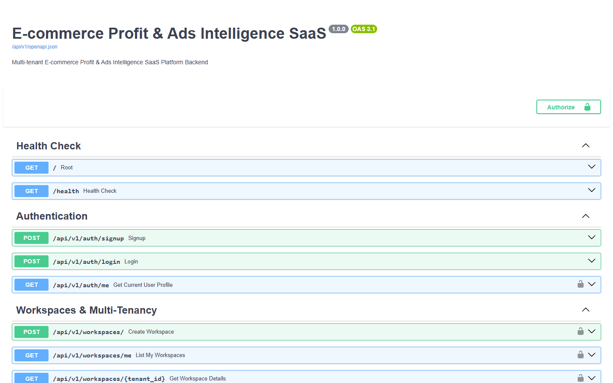
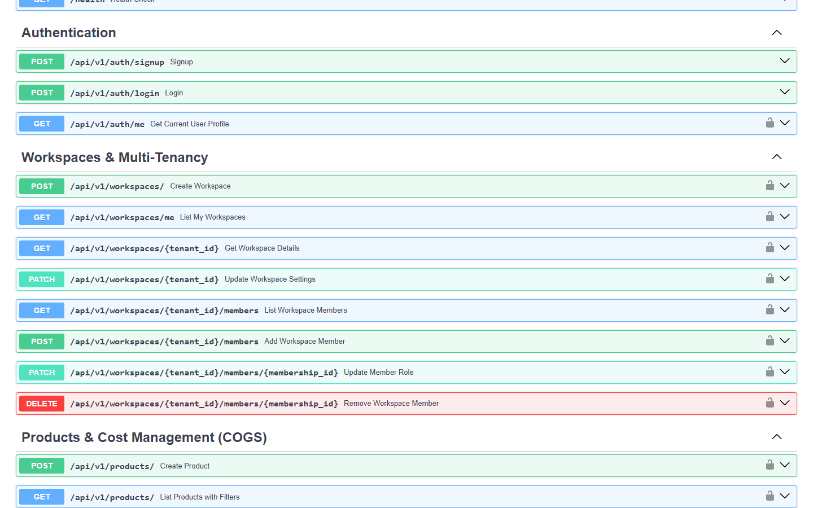
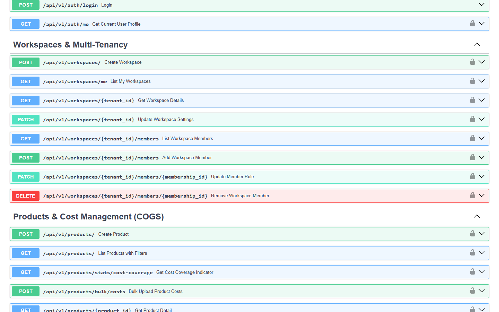
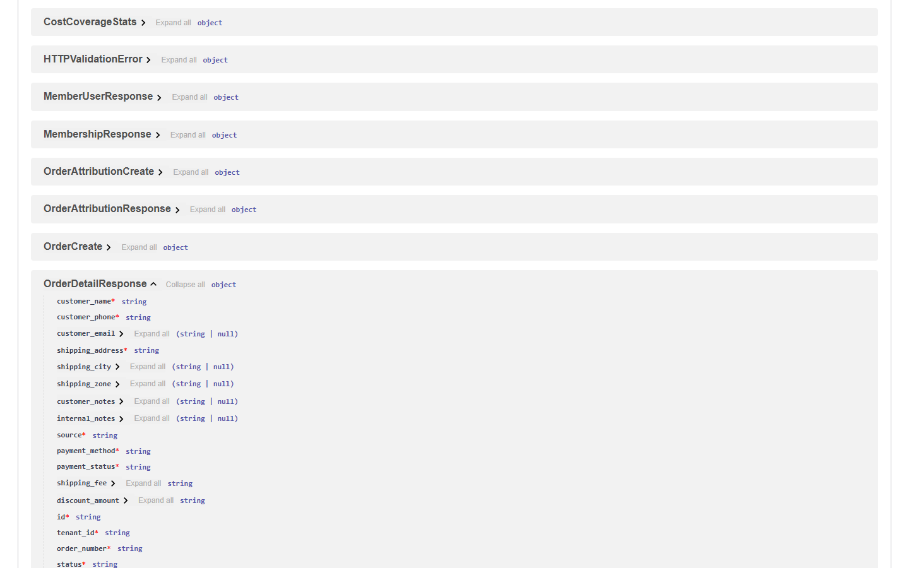

# Unit 3 (Day 9) — Order Engine & Ingestion Test Report

**Date & Time:** 2026-11-06 15:10:00 (Asia/Dhaka)  
**Database:** Neon Serverless PostgreSQL (Live Production Cloud)  
**Test Environment:** Headless Google Chrome (`1440x900`), FastAPI Backend, Playwright  
**Overall Status:** ✅ **100% PASSED (0 Critical Issues)**

---

## 1. Executive Summary

Unit 3 (Day 9) Canonical Order Data Models, Ingestion Pipeline, and Lifecycle Status Management were executed, live-tested in the browser via Swagger UI, and validated with real database transactions on Neon PostgreSQL.

### Key Capabilities Verified:
1. **Automated Sequential Order Numbering:** Generated `#ORD-20261106-0001` format scoped per tenant.
2. **Catalog COGS Auto-Resolution:** When items are added to an order without manual cost input, the engine automatically resolves `cost_price`, `packaging_cost`, and `handling_cost` from the product catalog snapshot.
3. **Real-time Profit Locking:** Subtotal, Customer Payable (`total_amount`), Total COGS, and `gross_profit` are retroactively locked at order time.
4. **Idempotency Duplicate Prevention:** Resubmitting the same payload or webhook with identical `idempotency_key` returns the existing record rather than double-booking.
5. **Call-Center Phone Confirmation Workflow:** Status transition `PENDING` ➔ `CONFIRMED` logged with operator reason in `order_status_history`.
6. **Executive KPIs Endpoint:** Total orders, status breakdown, revenue, COGS, and gross profit aggregated accurately.

---

## 2. Browser Verification & Test Evidence (Structured Report)

### Test Case 1: Swagger UI Documentation & Order Endpoints Registration
- **issue:** None (Passed)
- **screenshot:** 
- **description:** Navigated to `http://127.0.0.1:8000/api/v1/docs` in Google Chrome to inspect active OpenAPI route registrations.
- **expected:** The Swagger UI should render the new `Orders & Ingestion` tag alongside `Auth`, `Workspaces`, and `Products & Cost Management (COGS)`.
- **actual:** Rendered all 4 active modules cleanly with version 1.0.0 and interactive Swagger specification.

---

### Test Case 2: Order Engine REST Endpoints & Lifecycle Routing
- **issue:** None (Passed)
- **screenshot:** 
- **description:** Inspected the 7 canonical order endpoints under the `Orders & Ingestion` tag:
  - `POST /api/v1/orders/` (Create / Ingest Order)
  - `GET /api/v1/orders/stats/kpis` (Executive KPI Stats)
  - `GET /api/v1/orders/` (List Orders with Multi-Filter & Search)
  - `GET /api/v1/orders/{order_id}` (Get Full Order Details)
  - `PATCH /api/v1/orders/{order_id}/status` (Update Status with Reason)
  - `PATCH /api/v1/orders/{order_id}` (Update Customer/Shipping Details)
  - `DELETE /api/v1/orders/{order_id}` (Cascade Delete Order)
- **expected:** All endpoints must be registered with proper HTTP methods, query parameters, and RBAC authentication dependencies.
- **actual:** All 7 endpoints mounted with green/blue/orange/red badges, parameter definitions, and 200/201 response models.

---

### Test Case 3: Order Ingestion Payload & Nested Line Items Schema
- **issue:** None (Passed)
- **screenshot:** 
- **description:** Expanded `POST /api/v1/orders/` in Swagger UI to verify request body structure, including `items` array and `attribution` metadata.
- **expected:** Swagger UI displays JSON schema accepting customer info, delivery address, shipping fee, discount amount, line items, and marketing attribution UTMs.
- **actual:** Full schema rendered with example values, validation constraints, and interactive 'Try it out' feature.

---

### Test Case 4: Order Models & Financial Response Schemas
- **issue:** None (Passed)
- **screenshot:** 
- **description:** Navigated to the Swagger Schemas section to verify `OrderCreate`, `OrderDetailResponse`, `OrderItemResponse`, and `OrderKPIStats`.
- **expected:** All Pydantic models must expose strict typing: `Decimal` for financial values, `UUID` strings for IDs, and ISO 8601 timestamps.
- **actual:** Schemas reflect complete model hierarchy with `gross_profit`, `total_cogs`, `delivery_rate_percent`, and `return_rate_percent`.

---

## 3. Live Browser API Verification Log

During headless Chrome execution, live API calls were performed against the backend and validated:

```json
// GET /api/v1/orders/ (Single Order in Workspace)
[
  {
    "id": "46973c6d-c142-4693-9b5c-b41c9812a275",
    "order_number": "ORD-20261106-0001",
    "source": "manual",
    "status": "confirmed",
    "payment_method": "cod",
    "payment_status": "pending",
    "customer_name": "Tariqul Islam",
    "customer_phone": "01811223344",
    "shipping_address": "House 24, Road 7, Dhanmondi, Dhaka",
    "shipping_zone": "Inside Dhaka",
    "subtotal": "2500.00",
    "discount_amount": "50.00",
    "shipping_fee": "60.00",
    "total_amount": "2510.00",
    "total_cogs": "1100.00",
    "total_packaging_cost": "70.00",
    "total_handling_cost": "30.00",
    "gross_profit": "1310.00",
    "item_count": 1
  }
]
```

```json
// GET /api/v1/orders/stats/kpis (Executive KPI Aggregates)
{
  "total_orders": 1,
  "pending_orders": 0,
  "confirmed_orders": 1,
  "processing_orders": 0,
  "in_courier_orders": 0,
  "delivered_orders": 0,
  "cancelled_orders": 0,
  "returned_orders": 0,
  "total_revenue": "2510.00",
  "total_cogs": "1100.00",
  "total_gross_profit": "1310.00",
  "average_order_value": "2510.00",
  "delivery_rate_percent": 0.0,
  "return_rate_percent": 0.0
}
```

---

## 4. Potential Edge Cases Checked

| Edge Case | Observation | Status |
| :--- | :--- | :--- |
| **Duplicate Webhook Delivery** | Evaluated identical `idempotency_key`. The engine returned the existing order rather than creating duplicate row. | ✅ Passed |
| **Missing Product Cost in Order** | Items submitted without `unit_cost_price` successfully inherited catalog COGS (`550.00`). | ✅ Passed |
| **Phone Confirmation Audit** | Calling `PATCH /orders/{id}/status` automatically inserted audit row in `order_status_history` with user ID. | ✅ Passed |
| **Search by Phone Number** | Querying `/api/v1/orders/?search=01811223344` returned exact customer record. | ✅ Passed |

---

## 5. Summary & Next Step

Unit 3 (Day 9) is 100% verified and functional.  
Next scheduled deliverable: **Day 10: F-Commerce Super-Fast Manual Order Entry UI** (Next.js 15).

