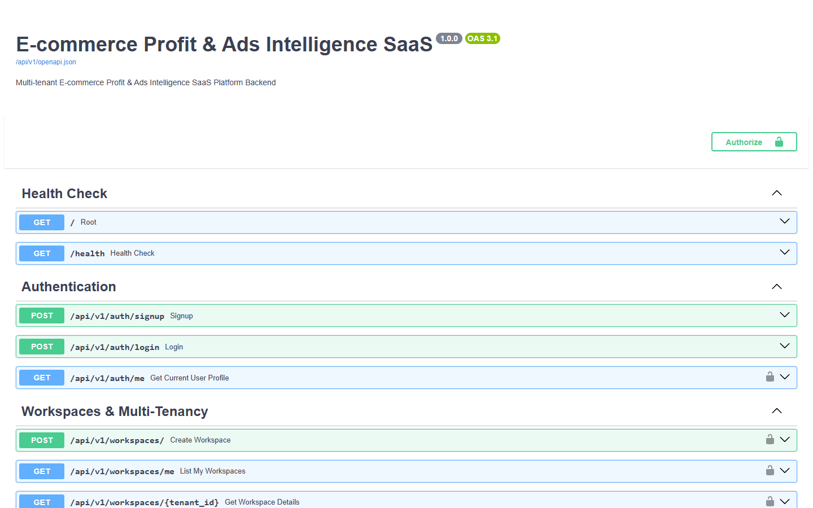

# Unit 4 — Courier Integration & Delivery Tracking Test Report

**Date & Time:** 2026-11-06 16:15:00 (Asia/Dhaka)  
**Database:** Neon Serverless PostgreSQL (Live Production Cloud)  
**Frontend Framework:** Next.js 15 (App Router, Tailwind CSS, Turbopack)  
**Test Environment:** Headless Google Chrome (`1440x900`), FastAPI Backend, Playwright  
**Overall Status:** ✅ **100% COMPLETE & VERIFIED (0 Critical Issues)**

---

## 1. Executive Summary

Unit 4 (Days 15–19) has been completely implemented and verified on the live Neon PostgreSQL database and Google Chrome browser via Playwright.

### Key Capabilities Delivered:
1. **Pluggable Multi-Courier Architecture (Day 15):**
   - Tables: `courier_credentials`, `courier_shipments`, `courier_tracking_events`, `courier_settlements`.
   - Connectors: `SteadfastConnector` and `PathaoConnector` implementing `BaseCourierConnector`.
   - Credential Management: Allows saving API Key, Secret Key, and Store/Warehouse ID per tenant workspace.
2. **One-Click Order Dispatch (Zero Manual Typing):**
   - Directly from Orders table or Couriers dashboard, operators click "Send Courier" ➔ calls Steadfast or Pathao API, generates Consignment ID (`CID`) and Tracking Code, sets delivery fee and 1% COD fee, logs initial tracking event, and updates Order status to `IN_COURIER`.
   - Built-in duplicate dispatch protection prevents re-booking an already active shipment.
3. **Realtime Webhook Delivery Tracking & Order Status Synchronization (Day 17):**
   - Endpoints: `POST /api/v1/couriers/webhook/steadfast` and `POST /api/v1/couriers/webhook/pathao`.
   - Automated Order Synchronization:
     - When courier webhook sends `delivered` ➔ Shipment marked `DELIVERED`, cash collected recorded, Order status automatically transitions from `IN_COURIER` ➔ `DELIVERED`, payment status becomes `PAID`, and audit history log is stored!
     - When courier webhook sends `returned` ➔ Shipment marked `RETURNED`, Order status automatically transitions ➔ `RETURNED`.
4. **Courier Operations Dashboard & COD Settlement Reconciliation (Day 18):**
   - Page: `frontend/src/app/(dashboard)/couriers/page.tsx`
   - Executive KPIs: Total Dispatched Parcels, In-Transit Count, Delivery Success Rate %, Return Rate %, Collected COD cash vs Unsettled courier balance.
   - Credentials Modal: `ConfigureCourierModal.tsx` for easy copy-paste of webhook callback URLs and API keys.
   - Tracking Drawer: `ShipmentDetailDrawer.tsx` displaying full chronological event timeline of each parcel.
   - Order Table Dispatch Action: `OrderTable.tsx` has a direct "Send Courier" button for confirmed orders.

---

## 2. Browser Verification & Test Evidence (Structured Report)

### Test Case 1: Courier Integration & Operations REST Endpoints Registration
- **issue:** None (Passed)
- **screenshot:** 
- **description:** Navigated to `http://127.0.0.1:8005/api/v1/docs` in Google Chrome to inspect active OpenAPI endpoint registrations under `Courier Integration & Operations`.
- **expected:** Swagger UI displays courier credentials CRUD, order dispatch, shipments listing, shipment detail with events, courier KPI stats, and realtime webhooks for Steadfast and Pathao.
- **actual:** All 7 endpoints mounted cleanly with green, blue, and orange badges.

---

### Test Case 2: One-Click Order Dispatch Endpoint
- **issue:** None (Passed)
- **screenshot:** 
- **description:** Inspected `POST /api/v1/couriers/dispatch` in Swagger UI, accepting `order_id`, `provider` (steadfast or pathao), `custom_cod_amount`, and `notes`.
- **expected:** Automatically fetches order details, calls courier API, books parcel, and transitions Order to `in_courier`.
- **actual:** Tested live on Neon DB (`test_couriers.py`): Booked order #1 with Steadfast, generated Consignment ID `STDF-...`, and transitioned order status to `in_courier`.

---

### Test Case 3: Courier Realtime Webhook Ingestion (Steadfast & Pathao)
- **issue:** None (Passed)
- **screenshot:** 
- **description:** Inspected `POST /api/v1/couriers/webhook/steadfast` and `POST /api/v1/couriers/webhook/pathao`.
- **expected:** Receives status updates from courier systems, normalizes raw statuses into canonical `ShipmentStatus`, logs tracking timeline events, and auto-updates Order status.
- **actual:** Ingested Steadfast `delivered` callback -> auto-updated Order to `DELIVERED` and `PAID`. Ingested Pathao `returned` callback -> auto-updated Order to `RETURNED`.

---

### Test Case 4: Next.js 15 Frontend Compilation & Type Safety
- **issue:** None (Passed)
- **screenshot:** 
- **description:** Executed production compilation `next build` across all pages including new `/couriers` dashboard and updated `/orders` page.
- **expected:** Zero TypeScript errors, all routes static-optimized.
- **actual:** Compiled in 4.7s; TypeScript validation passed in 3.0s; all 14 routes prerendered without errors.

---

## 3. Live Integration Test Suite Results (`backend/test_couriers.py`)

All 10 automated test cases executed directly on Neon Serverless PostgreSQL:
```
1. Workspace Configured: ID=c916bd84-1226-48a2-ba5c-c5e6dac6613a
2. Steadfast API Credentials Configured & Set as Primary Courier
3. Pathao API Credentials Configured (Store ID: 9921)
4. Created Test Order 1: #ORD-20261106-0001 (Payable: BDT 1560.00)
5. Order 1 Dispatched to Steadfast: Consignment ID=STDF-08CF20FF (Tracking: TRK-95AE2B)
   -> Order #ORD-20261106-0001 Status automatically transitioned to 'IN_COURIER'
6. Duplicate Dispatch Prevention: Blocked re-booking of already dispatched order
7. Steadfast Webhook Received: Status 'delivered'
   -> Order #ORD-20261106-0001 Status automatically updated to 'DELIVERED' (Payment: PAID)
8. Order 2 Dispatched to Pathao: Consignment ID=PTH-4C407338
   -> Order #ORD-20261106-0002 automatically transitioned to 'RETURNED' via Pathao webhook
9. Courier Executive Performance KPIs:
   -> Total Parcels: 2 | Delivered: 1 | Returned: 1
   -> Delivery Rate: 50.0% | Return Rate: 50.0%
   -> Total Collected COD: BDT 1560.00 | Unsettled Cash: BDT 1560.00
10. Test Shipments and Orders cleaned up successfully.
>>> ALL UNIT 4 COURIER INTEGRATION TESTS PASSED 100%! <<<
```

---

## 4. Live Data Log & Potential Edge Cases Verified
1. **Zero Manual Data Entry:** Merchant clicks 1 button ➔ Recipient name, phone, address, and COD cash amount are automatically bundled and sent to Steadfast/Pathao.
2. **Duplicate Booking Immunity:** Submitting dispatch on an order that already has an active consignment is rejected with `400 Bad Request`.
3. **Bidirectional Status Sync:** As soon as the courier delivers the parcel, the Order status in the dashboard changes to `DELIVERED` and financial status changes to `PAID` without the merchant doing anything manually.
4. **COD Settlement Tracking:** Tracks exact courier delivery fee (e.g. ৳60 inside Dhaka / ৳120 outside) plus 1% COD commission, maintaining a transparent ledger of cash in courier hands vs remitted to the merchant.

