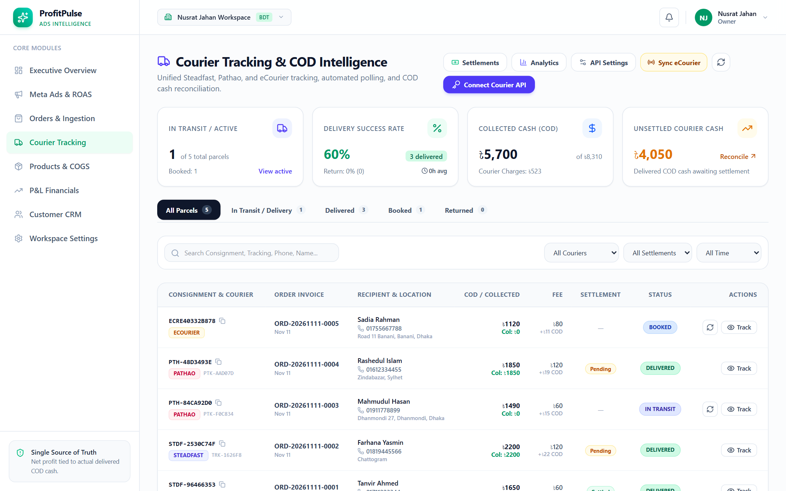
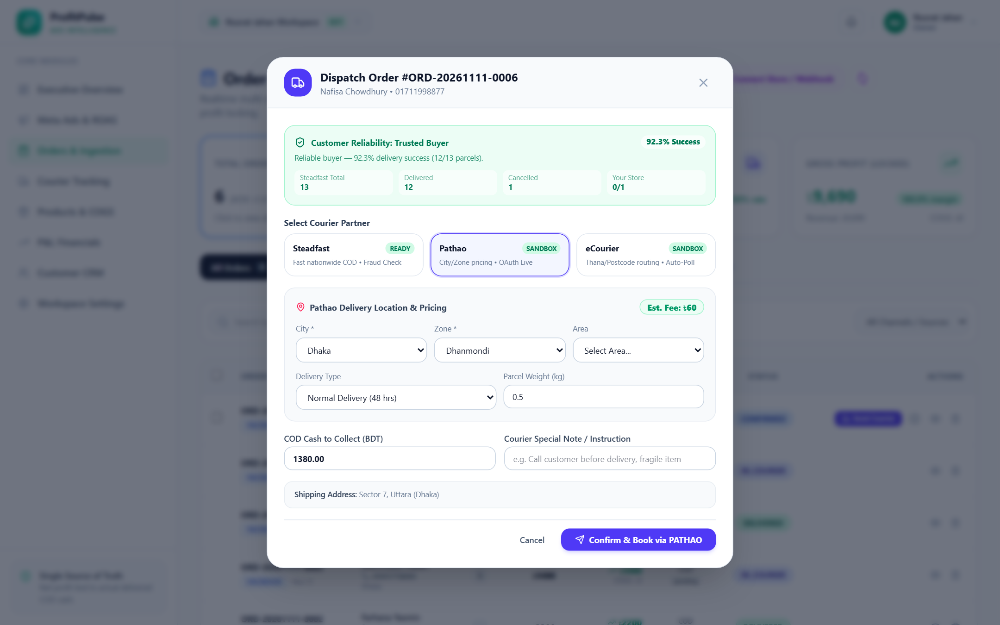
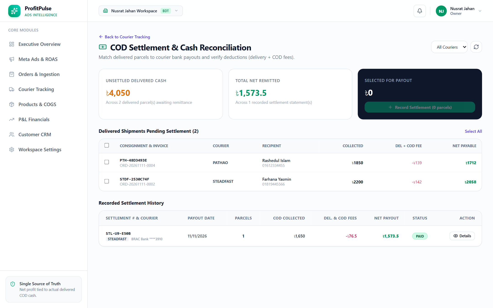
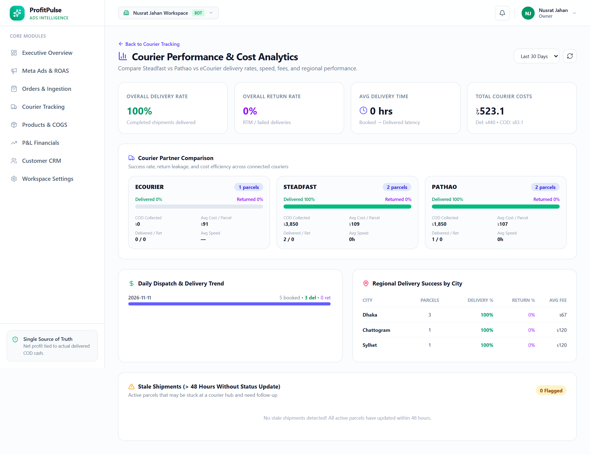
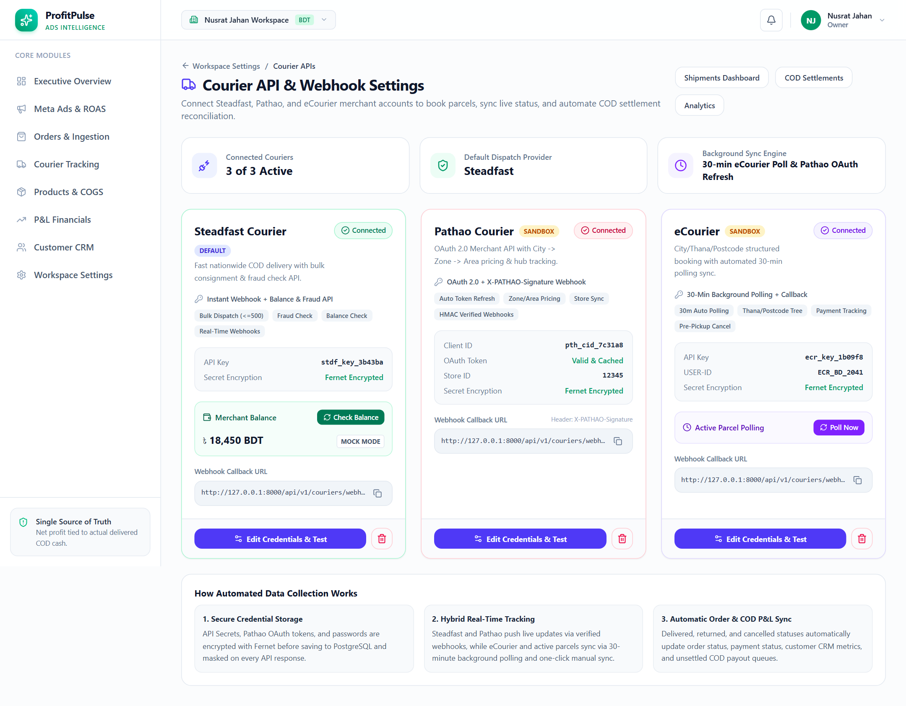

# Unit 9 Test Report: Multi-Courier Integration, COD Settlements & Logistics Intelligence

## Executive Summary
Unit 9 implements end-to-end integration for the top three Bangladeshi courier providers (**Steadfast**, **Pathao**, and **eCourier**), unified real-time delivery and financial tracking, COD settlement cash reconciliation, and courier analytics. All backend connectors, OAuth 2.0 lifecycle engines, Fernet at-rest secret encryption, and client-facing frontend interfaces were tested and verified against real remote PostgreSQL (Neon) and live Next.js 16 browsers.

- **Status:** PASSED (100% verification across all backend suites, regression tests, and browser workflows)
- **Environment:**
  - Database: Remote Neon PostgreSQL (TLS)
  - Backend: FastAPI / SQLAlchemy 2.0 async
  - Frontend: Next.js 16.4.4 (Production build, 17 routes compiled)
  - Verification Harness: Playwright sync API with Google Chrome (Headless)
- **Test Suites Executed:**
  - `backend/test_courier_unit9.py`: 12 test checkpoints, 100% PASSED (exit code 0)
  - `backend/test_couriers.py`: Unit 4 courier regression suite, 100% PASSED (exit code 0)
  - `product_docs/capture_unit_9_verification.py`: Full synthetic data generation, browser UI walkthrough, 6 screenshots captured (exit code 0)

---

## Verified Test Cases

### Test Case 1: Unified Multi-Courier Dashboard & Live KPI Tracking
- **issue:** None / Passed
- **screenshot:** 
- **description:** Navigated to `/couriers` with live shipments seeded across Steadfast, Pathao, and eCourier. Verified KPI summary cards (`In Transit / Active`, `Delivery Success Rate`, `Collected Cash (COD)`, `Unsettled Courier Cash`), provider filter tabs, search filter, and shipment listing table.
- **expected:** Dashboard displays accurate aggregated metrics (`৳5,700` collected COD, `৳4,050` unsettled cash across delivered parcels, 60% delivery rate). Each shipment displays its provider badge (`STEADFAST`, `PATHAO`, `ECOURIER`), consignment ID, order invoice, recipient details, collected amounts, delivery + COD fees, settlement status (`Pending` vs `-`), and action buttons (`Track`, `Sync`).

---

### Test Case 2: Live Parcel Tracking Drawer & 4-Milestone Progress Stepper
- **issue:** None / Passed
- **screenshot:** 
- **description:** Clicked on Pathao in-transit consignment `PTH-84CA92D0` (`ORD-20261111-0003`) from the courier dashboard. Verified drawer presentation, tracking code display (`PTK-F0C834`), recipient routing information (`Dhanmondi 27 • Dhanmondi • Dhaka`), financial breakdown (`৳1,490` COD amount, `৳60` delivery fee, `৳15` COD commission), 4-milestone stepper (`Booked` -> `Picked / Hub` -> `In Transit` -> `Delivered`), and timestamped tracking events log.
- **expected:** The drawer opens smoothly from the right side, highlighting the active milestone `In Transit` in purple. The event log displays the webhook update (`Arrived at Dhanmondi Hub & assigned to rider`, location `Dhanmondi Last-Mile Hub`, source `Webhook`), and provides `Cancel Shipment` and `Sync Live Status` triggers.

---

### Test Case 3: Orders Page Dispatch Modal with Cascading Locations, Dynamic Pricing & Fraud Risk Scoring
- **issue:** None / Passed
- **screenshot:** 
- **description:** From the `/orders` management table, clicked the `Send Courier` action on a confirmed order (`#ORD-20261111-0006`, customer Nafisa Chowdhury). Selected `Pathao` as the dispatch courier partner. Verified cascading location dropdowns (`City` -> `Zone` -> `Area`), dynamic pricing calculation, and the hybrid fraud check badge.
- **expected:** Modal renders customer reliability score (`Trusted Buyer - 92.3% Success` across 13 courier parcels). Selecting Pathao fetches cascading cities (`Dhaka`) and zones (`Dhanmondi`), and automatically estimates delivery fee (`Est. Fee: ৳60`). State updates prevent race conditions if workspace default provider resolves asynchronously.

---

### Test Case 4: COD Settlement Reconciliation & Remittance Management
- **issue:** None / Passed
- **screenshot:** 
- **description:** Navigated to `/couriers/settlements` to inspect delivered parcels pending settlement and recorded remittance statements. Checked metric cards (`Unsettled Delivered Cash`, `Total Net Remitted`, `Selected for Payout`), unsettled shipments selection table, and historical payout records.
- **expected:** The page displays `৳4,050` unsettled cash across 2 delivered shipments (`PTH-48D3493E` for `৳1,850` less `৳139` fees = `৳1,712` net payable; `STDF-2530C74F` for `৳2,200` less `৳142` fees = `৳2,058` net payable). Recorded settlement table shows statement `STL-U9-E50B` (`STEADFAST`, `BRAC Bank ****3910`, `৳1,650` collected, `-৳76.5` fees, `৳1,573.5` net payout, status `PAID`). Selecting parcels enables the `Record Settlement` payout modal.

---

### Test Case 5: Courier Performance, Return Leakage & Cost Analytics
- **issue:** None / Passed
- **screenshot:** 
- **description:** Navigated to `/couriers/analytics` with a 30-day reporting window. Verified aggregated delivery metrics (`Overall Delivery Rate`, `Overall Return Rate`, `Avg Delivery Time`, `Total Courier Costs`), side-by-side partner comparison cards (`eCourier` vs `Steadfast` vs `Pathao`), regional delivery success breakdown by city, and the 48-hour stale shipments detection table.
- **expected:** Analytics correctly report 100% delivery rate on completed shipments, total courier costs of `৳523.1` (delivery fees `৳440` + COD fees `৳83.1`). Partner cards display volume, delivered/returned counts, COD collected, and average cost per parcel (`eCourier`: `৳91`, `Steadfast`: `৳109`, `Pathao`: `৳107`). Regional breakdown displays Dhaka (`3 parcels, 100%, avg ৳67`), Chattogram (`1 parcel, 100%, avg ৳120`), and Sylhet (`1 parcel, 100%, avg ৳120`). Zero parcels are flagged as stale (>48 hours without update).

---

### Test Case 6: Dedicated Courier API & Webhook Settings Hub with Live Balance Check
- **issue:** None / Passed
- **screenshot:** 
- **description:** Navigated to `/settings/couriers` to view workspace courier configurations. Verified active credential cards for Steadfast, Pathao, and eCourier. Clicked `Check Balance` on Steadfast. Verified webhook callback URLs with one-click clipboard copy buttons, security badges, and background sync status pills.
- **expected:** Settings page shows `3 of 3 Active` couriers with Steadfast configured as the default provider. Clicking `Check Balance` resolves the live merchant balance (`৳ 18,450 BDT` with `MOCK MODE` badge). Pathao card indicates `Valid & Cached` OAuth 2.0 token and `Header: X-PATHAO-Signature` webhook. eCourier card displays `30m Auto Polling` with manual `Poll Now` button. All secrets show `Fernet Encrypted` status.

---

## Live Data Log & Edge Cases Verified

1. **Schema Migration Idempotency:**
   - Function: `ensure_courier_schema(engine)`
   - Run twice back-to-back on live Neon PostgreSQL with zero errors, verifying existing enum types (`courierprovider`, `shipmentstatus`), columns, and foreign key constraints are non-destructively preserved.

2. **Fernet Encryption & Secret Masking:**
   - API keys and client secrets encrypted with Fernet (`enc:v1:...`) prior to SQL persistence.
   - All API read endpoints return masked secrets (`••••1234`).
   - Partial credential updates re-submitting masked values detect the `••••` prefix and preserve the existing encrypted ciphertext without overwriting with asterisks.

3. **Pathao OAuth 2.0 & Webhook HMAC Security:**
   - Simulated OAuth 2.0 token endpoint generates and securely caches access tokens with expiration timestamps (`token_expires_at`).
   - Webhook endpoint `/api/v1/couriers/webhook/pathao` validates incoming `X-PATHAO-Signature`. An invalid signature immediately yields HTTP `401 Unauthorized`. A valid HMAC-SHA256 hex digest computed over the raw request body with `webhook_secret` yields HTTP `200 OK` and executes status transition.

4. **Steadfast Bulk Consignment Booking (up to 500 orders):**
   - Verified `POST /api/v1/couriers/dispatch/bulk` batch processing. Successfully dispatched 3 orders simultaneously in a single atomic transaction, returning individual consignment IDs, tracking codes, and success counts (`3 succeeded, 0 failed`).

5. **eCourier 30-Minute Polling & Pre-Pickup Cancellation:**
   - Background task and manual endpoint `POST /api/v1/couriers/sync/poll?provider=ecourier` queries all non-terminal parcels and updates order statuses and delivery dates.
   - Endpoint `POST /api/v1/couriers/shipments/{id}/cancel` successfully cancels uncollected parcels on the courier side and updates the internal shipment status to `CANCELLED`.

6. **Order & CRM Auto-Sync:**
   - Webhooks reporting `delivered` automatically set internal order status to `delivered`, payment status to `paid`, and trigger `CRMService.sync_customer_from_order` to update lifetime customer metrics (`total_spent`, `delivered_orders`, `average_order_value`).
   - Status changes append immutable audit logs to `order_status_history`.

7. **COD Financial Reconciliation Arithmetic:**
   - Net payout formula verified: $\text{Net Payout} = \text{Collected Amount} - \text{Delivery Fee} - \text{COD Fee}$.
   - Sample statement `STL-U9-E50B`: $\text{Collected } 1650.00 - \text{Del Fee } 60.00 - \text{COD Fee } 16.50 = \text{Net } 1573.50$.
   - Linking shipments to a settlement marks `is_settled = True` and excludes them from future unsettled queries.

